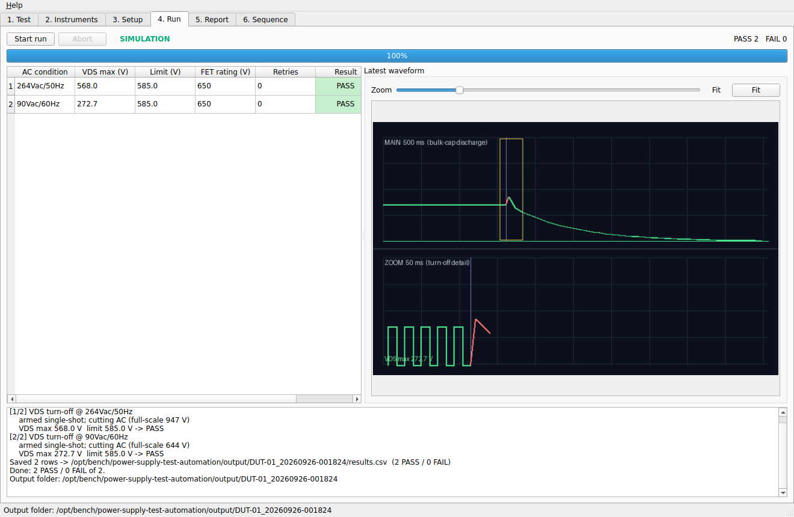
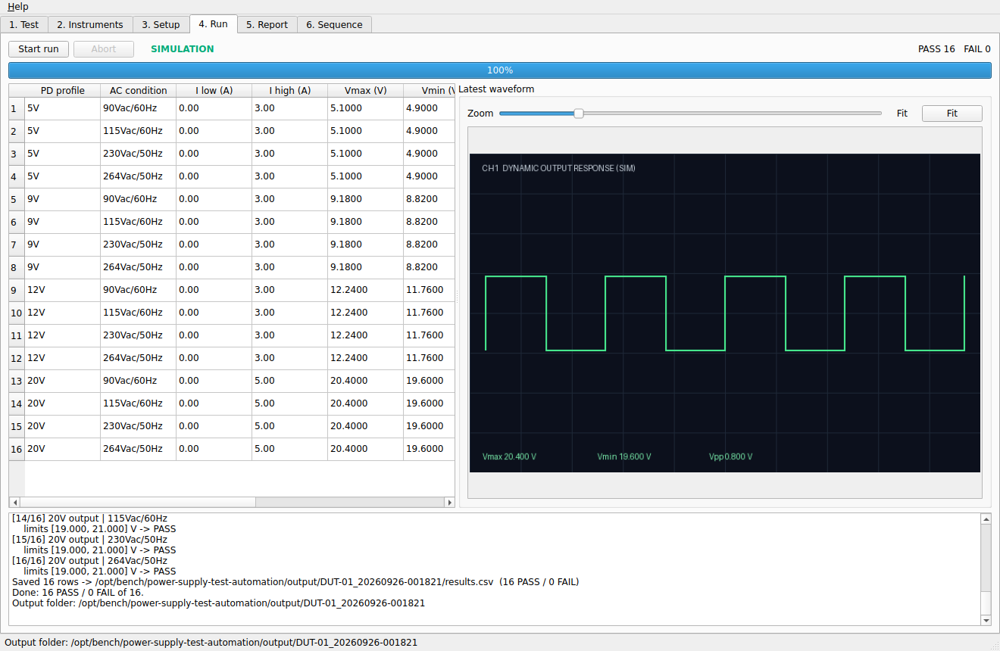
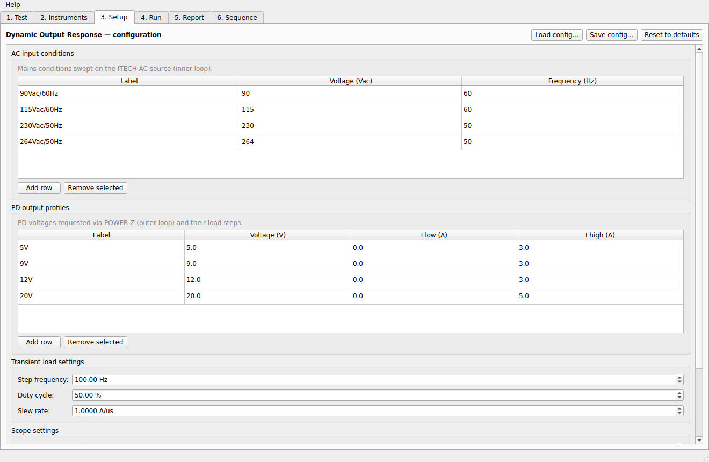
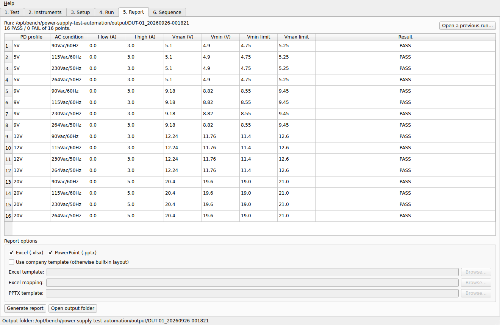

# Power Supply Test Automation

[](https://github.com/basel19982323-ux/power-supply-test-automation/actions/workflows/tests.yml)

CI runs with simulated instruments only: the tests, plus a headless demo of the three tests whose
Excel and PowerPoint reports are uploaded as the `simulation-demo-reports` artifact of each run.

**Dynamic Load Test** is a Windows desktop application that automates electrical verification tests on
power supplies (AC-DC adapters, USB-C PD chargers, flyback converters). It controls the bench
instruments over SCPI/VISA, runs the test matrix hands-off, judges every point PASS / FAIL / ERROR / NOT RUN against
limits, and writes Excel and PowerPoint reports.

An earlier, private version of this app was used on a real lab bench (see
[Validation status](#validation-status-real-bench-vs-simulation)). It automates the steps that are
otherwise done by hand for every test point: setting the AC input, stepping the load, adjusting the
oscilloscope, reading the values and copying them into a report.

**Author:** Basel Haijar · Electrical & Electronics Engineer · [LinkedIn](https://www.linkedin.com/in/basel-haijar)

## Engineering highlights

- **Instrument control over SCPI/VISA** for an ITECH AC source, an ITECH electronic load and a
  Yokogawa DLM oscilloscope (plus a POWER-Z USB-C PD decoy). Each driver keeps its commands in one
  table, so adapting to another model or firmware is a one-line change.
- **Three built-in tests:**
  - *Dynamic output response* (USB-C PD): load-transient sweep across PD profiles and AC input
    conditions; reads Vmax/Vmin and captures a waveform per point.
  - *V<sub>DS</sub> max at AC turn-off* (flyback primary MOSFET): cuts the AC input and single-shot
    captures the drain turn-off transient.
  - *V<sub>DS</sub> at OVP* (feedback break): triggers on the output rising and captures the peak
    drain voltage when over-voltage protection trips.
- **Automatic oscilloscope ranging**: measures the steady-state value first, sets the vertical scale,
  captures with peak detect and retries if the capture clips.
- **PASS/FAIL against derated limits**: the MOSFET V<sub>DS</sub> rating can be typed in or
  extracted from the component's datasheet PDF, then derated by a set margin.
- **Safety behaviour**: AC output off between conditions, load input off after each point, and an
  abort if a reading is far out of range (for example a bad probe). Before the AC is cut or the
  feedback is broken, the steady V<sub>DS</sub> is checked: impossible values are ERROR, and a
  value already above the limit is FAIL with no test event and the run stopped. The
  "1.5 × FET rating" top of the probe check is a provisional measurement check, not a safe voltage.
- **Pluggable test framework**: a new test type is one class; the GUI, runner, sequencing and
  reporting pick it up automatically.
- **Four results, not two**: PASS / FAIL / ERROR / NOT RUN, so a broken measurement is never
  reported as a good (or bad) product. Every ERROR has a fixed code and a reason.
- **Testable without hardware**: a simulation mode, plus a fake bench that speaks SCPI over TCP so the
  real drivers can be exercised, including fault injection (timeouts, bad replies, a lost
  connection, a scope that never triggers, ...). About 250 automated tests (pytest), run by CI.

**Tech:** Python · PySide6 (Qt) · PyVISA / SCPI · pytest · openpyxl · python-pptx · PyInstaller

## Validation status: real bench vs simulation

### Tested on real instruments: the earlier, private lab version

- All three tests (Dynamic Output Response, V<sub>DS</sub> max at AC turn-off and V<sub>DS</sub> at
  OVP) ran on a real lab bench with an **earlier, private version** of this app, using the
  **pyvisa-py** VISA backend.
- The real lab results are not part of this repository.

### Tested only in simulation and on the fake bench: this version

Everything added in this version has been tested **only** with the built-in simulator and with the
fake SCPI bench (`tools/fake_bench.py`, real drivers over TCP). **None of it has run on a real
instrument yet.**

| Feature | Real bench (earlier version) | Simulation | Fake bench (real drivers) |
|---|:---:|:---:|:---:|
| The three tests (the basic test flow) | Yes | Yes | Yes |
| PASS / FAIL / ERROR / NOT RUN with fixed error codes | No (new) | Yes | Yes |
| Safe reply parsing: NaN, garbage, wrong unit | No (new) | Yes | Yes |
| Clip check against the full scale read back from the scope | No (new) | Yes | Yes |
| New capture only (arm confirmed), no forced capture | No (new) | Yes | Yes |
| Probe check, and stop if the steady V<sub>DS</sub> is already over the limit | No (new) | Yes | Yes |
| E-load current check (load really reaches its current) | No (new) | Yes | Yes |
| Safe shutdown: OFF **sent** and OFF **confirmed** recorded separately | No (new) | Yes | Yes |
| Run-mode label SIMULATION / FAKE BENCH / LIVE in every report | No (new) | Yes | Yes |
| Fault injection (timeout, bad reply, lost connection, ...) | No | Partly | Yes |

**SCPI commands added in this version that have never been sent to a real instrument:**

| Instrument | Command | Used for |
|---|---|---|
| AC source | `OUTPut?` | confirm the output is really OFF |
| E-load | `MEASure:CURRent?` | check the load really draws its current |
| E-load | `INPut?` | confirm the input is really OFF |
| Scope | `:CHANnel<n>:VDIV?`, `:CHANnel<n>:OFFSet?` | read back the real full scale for the clip check |
| Scope | `:STATus:CONDition?` (running bit) | already polled before; now also used to confirm a new single-shot started |

**Before the first real run with this version:**

1. Confirm the probe type and the probe attenuation by hand (see [Real hardware](#real-hardware)).
2. Check that each command above is accepted and answers in a form the app understands. The
   drivers keep all commands in one `CMDS` table, so a different spelling is a one-line change.
3. Check the provisional thresholds against real readings: probe check (0.5× and 3× the AC peak,
   top never below 1.5× the FET rating) and load check (90 % of the expected average current,
   with the 100 Hz transient).
4. Check that the scope reports "running" after it is armed. If it triggers at once (for example
   the trigger level is below the normal signal), the app gives ERROR `STALE_CAPTURE`.

## How a point is judged

Every test point gets one of four results:

| Result | Meaning | Example |
|---|---|---|
| **PASS** | a real number, in the right unit, from a new capture, not clipped, within the limit | V<sub>DS</sub> max 568 V ≤ limit 585 V |
| **FAIL** | a trustworthy reading is outside the limit: the **product** failed | 600 V > 585 V; or a capture clipped at a 946.8 V full scale, shown as "≥ 946.8" |
| **ERROR** | the measurement can't be trusted: the **bench or setup** failed | `NO_TRIGGER`, `PROBE_CHECK`, `TIMEOUT`, ... |
| **NOT RUN** | never measured | the run stopped earlier, or Stop was pressed |

Every ERROR and NOT RUN has a fixed short code and a reason. The overall result is FAIL if any point
FAILs, otherwise ERROR or NOT RUN if any point is not PASS, and **PASS only if every point is
PASS**. `cli.py` returns the overall result as its exit code (PASS 0, FAIL 1, ERROR 2, NOT RUN 3;
4 if `--report` could not write the report). Results are coloured PASS green, FAIL red, ERROR
amber, NOT RUN grey in the app and in Excel.

## Screenshots

All screenshots are from **Simulation mode** (no hardware connected), so the values are simulated.
They were taken with an earlier version of the UI, before ERROR / NOT RUN and the run-mode label
were added.

**VDS max at AC turn-off (simulation)**: single-shot capture with the wide view (bulk-capacitor discharge) and the
zoomed turn-off detail, judged against the derated MOSFET rating:



**Dynamic output response (simulation)**: 16-point matrix (4 USB-C PD profiles × 4 AC input conditions) with the
latest waveform:



**Setup (simulation)**: AC conditions, PD profiles and transient settings are edited in tables and saved as YAML:



**Report (simulation)**: results with limits, exported to Excel and PowerPoint:



---

## Overview of the built-in tests

A Windows desktop application for **bench instrument test automation**. Built-in tests:

- **Dynamic Output Response** (USB-C PD): ITECH AC source + ITECH e-load + Yokogawa
  scope + POWER-Z. Sweeps PD output profiles × AC input conditions, reads Vmax/Vmin,
  captures a screenshot per point, PASS/FAILs against limits.
- **VDS Max — AC Turn-off** (flyback primary MOSFET): with the DUT running, cuts the AC
  input (AC source output OFF), single-shot captures the drain turn-off transient, and
  reads peak V_DS. The scope **auto-ranges** (measures steady-state V_DS to set the
  vertical scale, peak-detect capture, retry if the capture clips). PASS/FAIL vs. the FET
  V_DS rating × a derating margin — typed in, or extracted from an uploaded datasheet PDF.
- **VDS at OVP (feedback break)** (flyback primary MOSFET): the e-load holds a static load
  on the output; the app arms a single-shot triggered on **CH2 (output) rising** and
  prompts you to open the optocoupler switch (break the feedback loop). When the output
  jerks up to OVP it captures peak V_DS (CH1). Same auto-range/zoom/pass-fail as Turn-off,
  plus records the OVP output level.

Tests run **individually** (Test → Run) or **in succession** via the **Sequence** tab.
The core is a **pluggable test framework** — new test types slot in without touching the
GUI (see *Adding a test type* below).

---

## Quick start

```bat
setup.bat      :: one-time: create .venv and install dependencies
run.bat        :: launch the app
```

Requires Python 3.10+ on PATH. On first launch the app opens in **Simulation
mode**, so you can click through the entire workflow — run, live results,
reports — with **no hardware connected**.

Headless / CI smoke test (no GUI):

```bat
.venv\Scripts\python cli.py --simulate
.venv\Scripts\python cli.py --test vds_turnoff --simulate --report   :: also writes Excel + PPTX
.venv\Scripts\python -m pytest
```

---

## The workflow (six tabs)

1. **Test** — pick the test type and name the DUT.
2. **Instruments** — toggle **Simulation mode**, or enter VISA addresses for the
   AC source, e-load, and scope. **Scan** lists connected instruments; **Test**
   confirms each `*IDN?`. Choose the POWER-Z mode (manual/gui).
3. **Setup** — edit AC conditions, PD profiles, transient settings, and limits in
   tables/fields. **Save/Load** named configs (YAML).
4. **Run** — **Start**/**Abort**, a live progress table coloured by result
   (PASS / FAIL / ERROR / NOT RUN), all four counts, the overall result, and the latest
   waveform. If the AC source or e-load could not be confirmed OFF at the end, a
   "Bench may still be ON" warning appears. In manual POWER-Z mode a dialog asks
   you to set the decoy once per output voltage.
5. **Report** — generate Excel + PowerPoint (built-in layout or your company
   template) and open the output folder.
6. **Sequence** — assemble an ordered suite of tests (each a test type + saved config),
   **Run all** in succession with a result per step, then a combined report. After a
   bench problem the later steps are NOT RUN. Each step
   also writes its own timestamped run folder under `output/sequences/SEQ_<timestamp>/`.

Every run is saved to its own timestamped folder under `output/` (results never
overwrite each other; a second run in the same second gets `_2`):

```
output/<DUT>_<YYYYMMDD-HHMMSS>/
    results.csv
    run_info.json       run mode (SIMULATION / FAKE BENCH / LIVE) and the evidence,
                        and whether each instrument's OFF was sent and confirmed
    screenshots/*.png
    <DUT>_report.xlsx   <DUT>_report.pptx   (after you generate them)
```

---

## Real hardware

1. The VISA backend **pyvisa-py** (the one the earlier lab version used) is installed by
   `setup.bat`. For USB instruments and LAN discovery, also install:
   ```bat
   .venv\Scripts\python -m pip install pyusb psutil zeroconf
   ```
2. Connect the AC source, e-load, and scope (LAN recommended; USB works). On the
   Yokogawa enable the remote interface (Utility → Remote Ctrl → Network →
   VXI-11 ON for LAN).
3. In the app: **Instruments** → uncheck Simulation → **Scan** → assign each
   address → **Test** each → **Setup** your matrix → **Run**.

**Honest first-session expectations**: the
drivers use the standard ITECH and Yokogawa command sets, but exact SCPI syntax
varies by model/firmware. Each driver prints `*IDN?` on connect and keeps all
commands in one `CMDS` dict at the top of its file — if a command errors, check
that model's programming manual and fix one line. Plan ~1–2 hours of first-run
debugging with instruments live; after that a full 16-point matrix runs in
minutes, hands-off. Safety behaviour is built in: AC output off between
conditions, load input off after each point, a sanity-abort if a reading is
wildly out of range, and at the end of every run: load OFF, AC OFF, then the app
**asks each instrument whether it is really off**. "OFF sent" is not enough;
only the instrument's own answer counts, and if it can't be confirmed the app
warns that the DUT may still be live.

**Before any real-hardware run: confirm the probes by hand.** The engineer must
check the probe type (for example a high-voltage differential probe on the
MOSFET drain) and that the probe attenuation set in the app (Setup → "Probe
attenuation"; for OVP also "Output probe atten." on CH2) matches the probe
that is really connected. The app can't
detect every wrong setting. Its probe check only rejects readings that are not
believable:

| Wrong probe setting | Detected by the app? |
|---|---|
| Probe disconnected (about 0 V) | Yes: ERROR `PROBE_CHECK` |
| Attenuation 10× too low (reads 10× too low) | Yes, for a normal flyback: ERROR `PROBE_CHECK` |
| Attenuation 10× too high (reads 10× too high), 650 V FET | Yes: ERROR `PROBE_CHECK`, run stopped |
| 10× too high with a very high-voltage FET at low line | Not by the probe check; the reading is above the limit, so FAIL and the run stops (never PASS) |
| **Small errors, for example 2× too low** | **No.** The reading looks normal and **could PASS a bad DUT** |

The "1.5 × FET rating" top of the probe check is a provisional measurement
check, not a safe operating voltage. These thresholds were tested in
simulation and against the fake bench only, not yet on real instruments.

---

## Testing without hardware

Two levels:

- **Simulation mode** (in-app toggle) — replaces the drivers with fakes. Fast, no
  setup; exercises the UI, config, sequencing, and reports, but sends no SCPI.
- **Fake bench** (`tools/fake_bench.py`) — a virtual AC source + e-load + scope that
  speaks SCPI over TCP sockets, so the app's **real** drivers run against it (real
  PyVISA, SCPI, binary screenshot transfer, trigger polling). Needs `pyvisa-py`.

  ```bat
  python tools\fake_bench.py      :: prints TCPIP0::127.0.0.1::5025/5026/5027::SOCKET
  ```
  Then in the app: **Instruments tab → Simulation OFF**, enter those addresses (or on
  the Setup tab load `configs/fake_bench_vds.yaml`), and run. Headless equivalent:
  ```bat
  python cli.py --test vds_turnoff --config configs\fake_bench_vds.yaml
  ```
  The VDS test is fully realistic here (cutting AC completes the scope's single-shot,
  auto-range + retry, real waveform PNGs). **Caveat:** a self-consistent fake validates
  the *plumbing*, not whether the SCPI strings match your exact DLM/ITECH models — only
  a real instrument proves that. Select a different VISA backend with the
  `DLT_VISA_BACKEND` env var (default `@py`; e.g. `@sim` for pyvisa-sim).

### Fault-injection tests

The fake bench has fault switches (`FAULTS` in `tools/fake_bench.py`), and the tests in
`tests/test_fake_bench_faults.py` run the **real drivers** against a faulty bench. Each test checks
that no point is PASS, that the right ERROR code is given, and that the AC source and e-load OFF
was both **sent** and **confirmed by the instrument** (from the fake bench's own command log):

| Fault | Result |
|---|---|
| instrument does not answer | ERROR `TIMEOUT`, run stops |
| reply `ABC` instead of a number | ERROR `BAD_REPLY`, run stops |
| reply in the wrong unit, `5.680E+02A` | ERROR `WRONG_UNIT`, run stops |
| scope never triggers | ERROR `NO_TRIGGER` (no forced capture) |
| scope does not start a new capture | ERROR `STALE_CAPTURE` |
| VDS probe disconnected (about 0 V) | ERROR `PROBE_CHECK`, no test event |
| e-load draws only 1 A of 3 A | ERROR `LOAD_NOT_REACHED` |
| AC source drops the connection while ON | run stops; AC **not confirmed** OFF, warning |
| AC source ignores OFF | OFF sent, instrument says ON, warning |

With pyvisa-py a dropped connection shows up as a VISA timeout, so the code is `TIMEOUT`.

### CI demo

Every CI run also runs `cli.py --simulate --report` for the three tests and uploads the reports.
Open the run on the **Actions** tab and download **simulation-demo-reports**. The reports say
**Run mode: SIMULATION**.

## Reports & the company template

Without a template, the app writes a clean built-in layout. When you have the
company format, drop the file(s) into `reporting/templates/` and, on the Report
tab, tick **Use company template**:

- **Excel** — your `.xlsx` is filled per a small `mapping.yaml` (copy
  `reporting/mapping.example.yaml`): summary cells + where the results table
  starts. The data pipeline is identical to the default.
- **PowerPoint** — your `.pptx` is used as the theme/branding base for the
  generated deck. Per-placeholder mapping can be added once the real template's
  layout is known.

---

## Adding a test type

The GUI, runner, persistence, and reporting are all generic. To add a test:

1. Create `testtypes/<your_test>.py` with a `TestType` subclass implementing
   `default_config()`, `config_schema()`, `plan()`, and `execute_point()` (see
   `testtypes/dynamic_output_response.py` as the reference).
2. Register it in `testtypes/__init__.py` (`REGISTRY`).

That's it — it appears in the Test dropdown, gets a full Setup editor from its
`config_schema()`, runs with live monitoring, and reports automatically.

---

## Build a standalone .exe

```bat
build.bat      :: -> dist\DynamicLoadTest\DynamicLoadTest.exe
```

Distribute the whole `dist\DynamicLoadTest\` folder to a bench PC (no Python
install needed). For live hardware on that PC, the VISA backend must be bundled
or installed alongside.

---

## Project layout

```
main.py            app entry point            cli.py     headless engine runner
core/              engine: runner, config, results, sequence, VISA scan,
                   verdict (the four results + error codes), shutdown, run_mode,
                   datasheet (VDS-rating extractor), TestType base
  instruments/     drivers (real) + simulator + factory + safe reply parsing
testtypes/         pluggable tests: dynamic_output_response, vds_turnoff, vds_ovp
reporting/         Excel + PPTX builders, template-fill, sequence summary, templates/
ui/                PySide6 tabs + threaded run/sequence workers
configs/           saved test configs (YAML)
tools/             fake_bench.py: fake SCPI instruments with fault switches
tests/             pytest suite (results, readings, safety checks, shutdown, run mode,
                   fake-bench fault injection, reporting, sequence, ...)
```

---

## License

MIT License. See [LICENSE](LICENSE).
